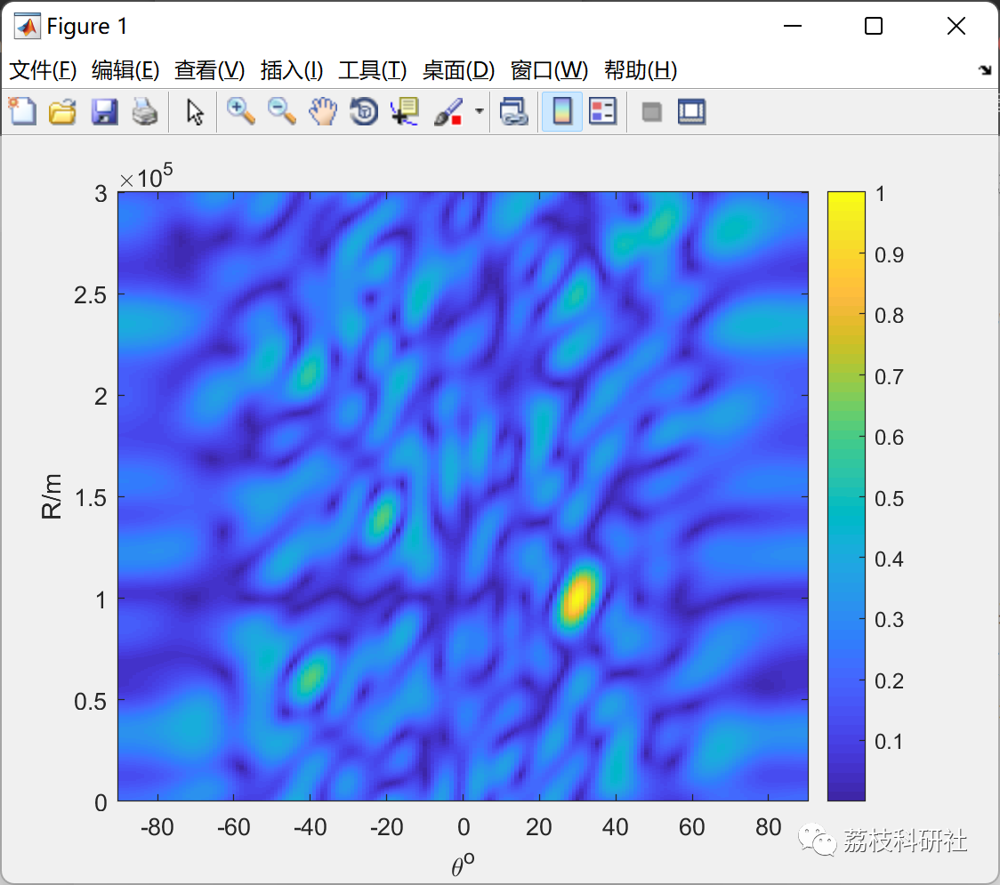
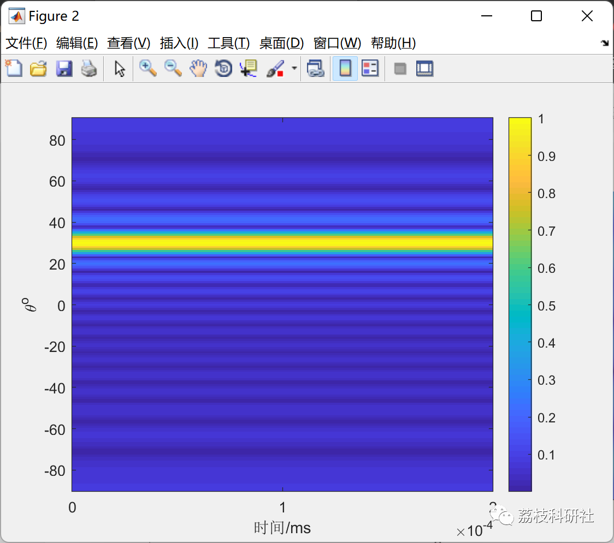
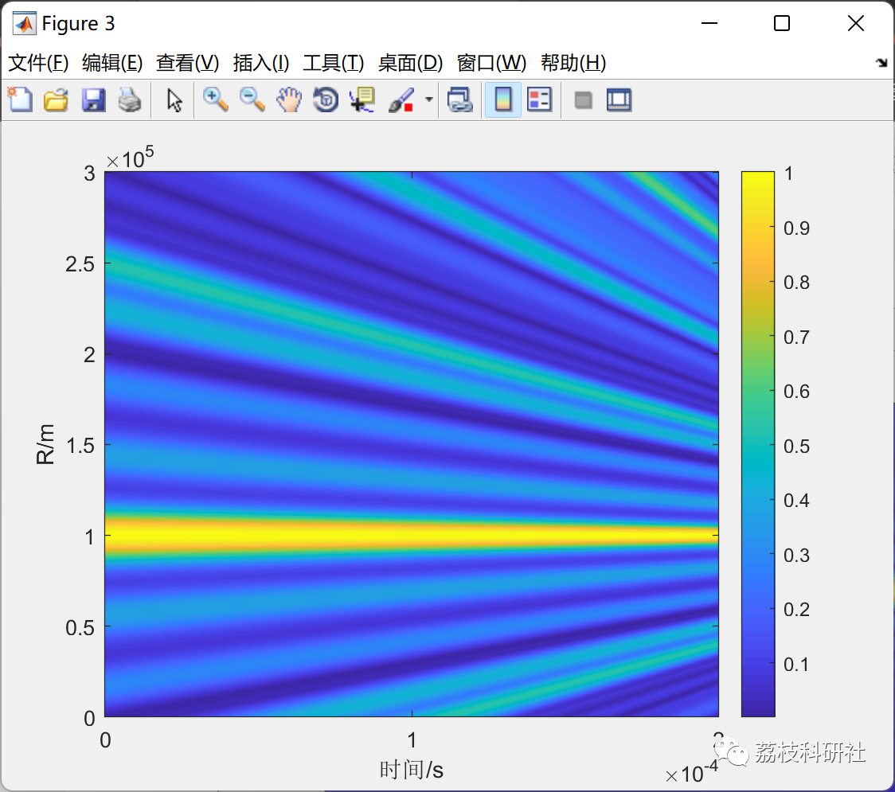
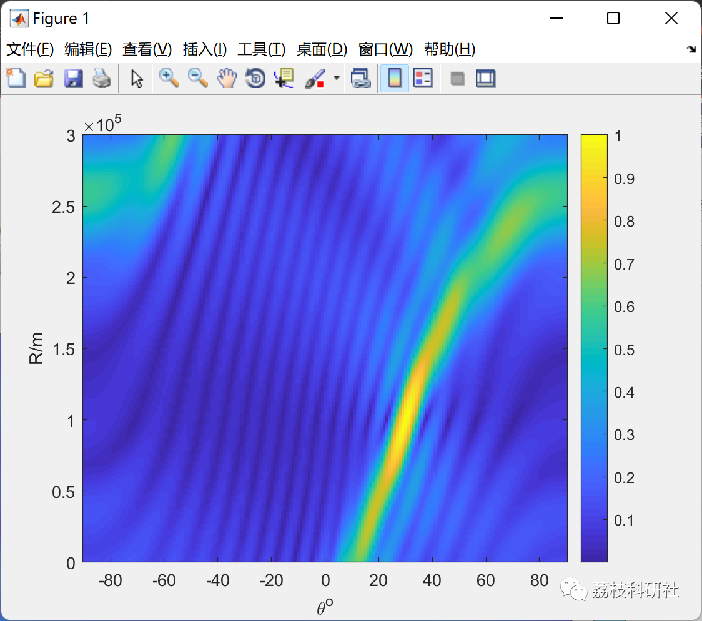
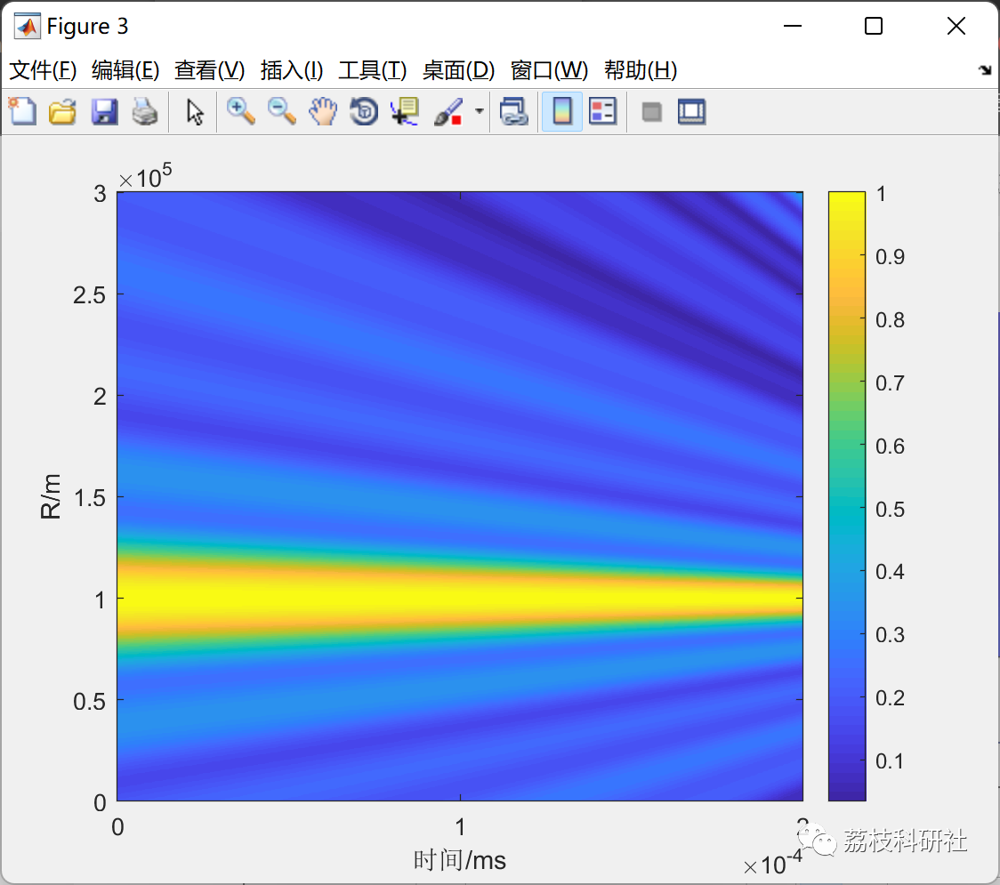

# Time-modulated nonlinear frequency offset detection based on particle swarm optimization algorithm (Matlab code implementation)

🎊🎉🎉🎉🎉 Welcome to our presence! 😊😊😊
📝 Bedside motto: I will always thank the hardworking self of the present!
🎁 Sectional directory link:
🌈🌈🌈 Path planning, neural network prediction, electrical code, intelligent algorithms and their applications, optimization dispatching, image processing, workshop dispatching, signal processing, romantic her, mathematical modeling🌟🌟🌟
🌈1 Overview
🌟2 Running results
⛳️3 References
💥4 Matlab code implementation
🌈1 Overview
This paper proposes a time-modulated nonlinear frequency deviation FDA based on Particle Swarm Optimization (PSO) algorithm to suppress the time-varying characteristics of the FDA beam directional pattern. The simulation results demonstrate that this method can suppress the time-varying characteristics of the FDA and obtains a better focused beam directional pattern compared to traditional time-varying suppression methods such as time-modulated frequency deviation and time-modulated nonlinear frequency deviation.
🌟2 Running results
⛳️3 References
[1] Chen Chushu, Sheng Chuan, Xie Junwei, Wang Bo, Shan Quanming. Nonlinear Frequency Deviation FDA for ECM System Deceit Research [J]. Air Force Engineering University Journal (Natural Science Edition), 2020, 21(03):70-77.​
[2] Gu Siqi. Frequency Control Beam Combination Technology and Its Optimal Design Research [D]. Nanjing University of Science and Technology, 2019. DOI:10.27241/d.cnki.gnjgu.2019.000853.
💥4 Matlab code implementation
tmfo_AF.m is the time-modulated frequency offset FDA (Frequency Division Multiplexing) steering vector function; TMFO_FDA is the simulation of time-modulated frequency offset FDA beam pattern; TMLFO_FDA is the simulation of time-modulated logarithmic frequency offset FDA beam pattern; non_liner_a.m is the steering vector function for nonlinear frequency offset FDA; cost_function1.m is the cost function for the Particle Swarm Optimization (PSO) algorithm; pso2.m is the vector function of each element's frequency offset coefficient after optimization by the PSO algorithm for FDA; pso_TMFO_fda.m is the simulation of the beam directional pattern of time-modulated nonlinear frequency offset FDA after optimization by the PSO algorithm.

## Images

<!-- PAYMENT_BLOCK -->

## Get this dataset

- Payment link (Stripe): [Buy now](https://buy.stripe.com/3cs8yP7sY87d0vu9AB)
- Payment QR code: 

<!-- /PAYMENT_BLOCK -->
